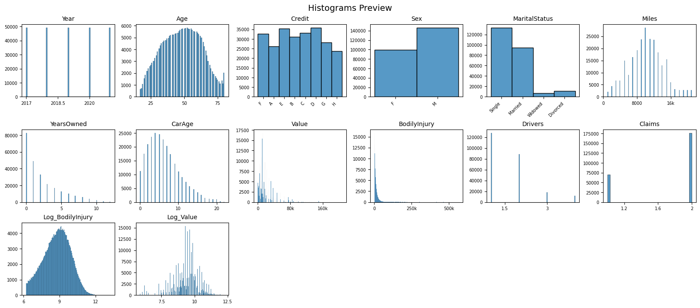
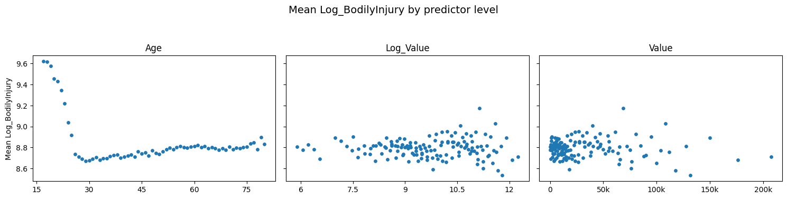
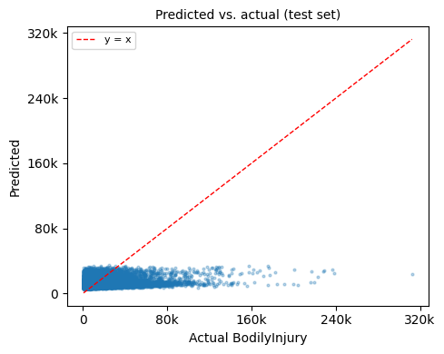
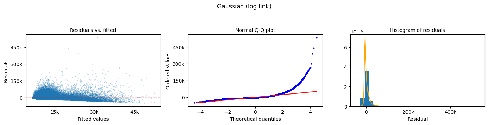
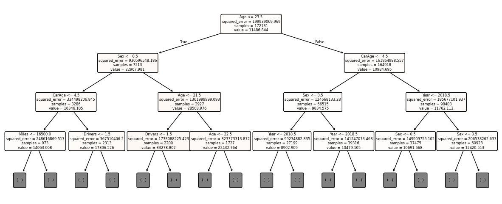
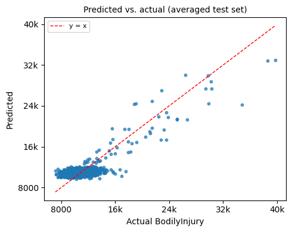

# Predicting Bodily Injury Claim Severity

[](https://colab.research.google.com/github/winutta/Predictive-Analytics-with-Python-Final-Project/blob/main/Predictive_Analytics_in_Python_Final_Project.ipynb)

Final project for *Predictive Analytics in Python*. The goal is to predict the dollar cost of an auto bodily-injury claim from policyholder and vehicle characteristics, using generalized linear models (GLMs) and comparing them against a decision tree.

**TL;DR**

- **Driver age is the dominant signal.** Claim cost falls steeply from age 17 to about 27, then stays roughly flat with a slight upward drift.
- **Individual claims are very noisy.** Every row-level model explains only about 4–5% of the variation (pseudo R² ≈ 0.05), and test RMSE is about \$13.8k–\$14.2k for all four models.
- **The signal is real, though.** Averaging 64 similar-aged records cancels most of the noise, and a simple GLM then reaches a test R² of about 0.74.
- **GLMs and trees agree** on what matters most, and the GLM is far easier to interpret.

---

## Table of contents

1. [Data](#data)
2. [Approach](#approach)
3. [Exploratory analysis](#exploratory-analysis)
4. [Feature engineering](#feature-engineering)
5. [Model results](#model-results)
6. [What the GLM says](#what-the-glm-says)
7. [Decision tree](#decision-tree)
8. [Aggregation analysis](#aggregation-analysis)
9. [Conclusions and limitations](#conclusions-and-limitations)
10. [Reproducing this project](#reproducing-this-project)

---

## Data

`auto_claims.csv` contains **250,000 policy records (2017–2021)**. There are no missing values.

| Variable | Definition | Type |
|---|---|---|
| `BodilyInjury` | Total bodily injury costs (**target**) | Numeric |
| `Year` | Policy year | Numeric |
| `Age` | Age of the primary driver | Numeric |
| `Credit` | Credit score, A to H (A is best) | Factor |
| `Sex` | M or F | Factor |
| `MaritalStatus` | Married, Divorced, Widowed, or Single | Factor |
| `Miles` | Vehicle mileage | Numeric |
| `Drivers` | Number of drivers | Numeric |
| `CarAge` | Age of the vehicle | Numeric |
| `Value` | Value of the vehicle | Numeric |
| `YearsOwned` | Years the main driver has owned the vehicle | Numeric |
| `Claims` | Number of people injured in the accident | Numeric |

> The CSV is not included in this repository. Place `auto_claims.csv` in the same folder as the notebook before running it.

## Approach

| Step | What happens |
|---|---|
| 1 | Exploratory data analysis, cleaning, log transforms |
| 2 | Relationships between predictors and the target, feature engineering |
| 3 | Choice of model family (GLM vs. tree) |
| 4 | Fit and evaluate three GLMs: Gaussian (identity), Gaussian (log), Inverse Gaussian (log) |
| 5 | Fit a decision tree for comparison |
| 6 | Control for noise by aggregating the data |

Rows were split randomly **70% train / 20% test / 10% holdout** (seed 1000). Models were fit on the training set (172,131 rows) and scored on the test set. The holdout set was set aside and never used.

## Exploratory analysis

`BodilyInjury` and `Value` are heavily right-skewed (the max claim is about \$565k, against a 75th percentile of about \$14k), so log versions were created. Two data decisions followed:

- **Rows with `Claims = 0` were dropped** (250,000 → 245,902 rows). `BodilyInjury` is 0 when there is no claim, and the model is meant to predict cost *given* a claim.
- **`Age` has a spike at exactly 80**, which most likely means "80 or older". This is speculation, so the values were left in.



Grouping the target by each predictor showed that `Age` has by far the clearest relationship. Mean log claim cost drops sharply from age 17 to the late 20s, then flattens with a slight rise. `Value` and `Log_Value` show no trend at all, so both were removed.



## Feature engineering

- **Piecewise age.** The kink near 27 motivated two variables: `AgeLow = min(Age, 27)` and `AgeHigh = max(Age, 27)`. This lets the model fit one slope below 27 and a different slope above it.
- **Encodings.** `Credit` became an integer `CreditNum` (A = 1 … H = 8), and `Sex` and `MaritalStatus` were coded numerically.
- **Dropped:** `Value` and `Log_Value`.
- `Claims` is **not** used as a predictor because it isn't known before the loss.

The final modeling table has 245,902 rows and 14 columns.

## Model results

All models were scored on the same held-out test set.

| Model | Test RMSE | Pseudo R² (train) |
|---|---|---|
| Gaussian, identity link | \$13,875 | 0.051 |
| **Gaussian, log link** | **\$13,846** | 0.055 |
| Inverse Gaussian, log link | \$13,861 | 0.037 |
| Decision tree (depth 10) | \$14,247 | n/a |

The Gaussian log-link GLM has the lowest RMSE, and it also guarantees positive predictions. The differences between models are small. **None of them predict individual claims well.**

The predictions stay inside a narrow band (roughly \$5k–\$35k) while actual claims run past \$250k, so large claims fall far below the diagonal:



The residuals are heavily right-skewed. The Q-Q plot shows a long upper tail that a Gaussian family does not capture:



### Variable selection

Predictors were pruned using coefficient p-values and **likelihood ratio tests** (LRTs), refitting the model once per predictor with that variable removed.

- **`YearsOwned`** is not significant in any case (LRT p ≈ 0.89 for Gaussian identity, 0.71 for Gaussian log). It was dropped.
- **`CreditNum`** is borderline in the identity-link model (p ≈ 0.054) and significant in the log-link LRT (p ≈ 0.006). It was dropped for simplicity and consistency across models.
- After dropping both, every remaining term is significant. `MaritalStatus` has the smallest LRT statistic of those left, so it is the next candidate for removal.
- For the **Inverse Gaussian** model, several LRT statistics came out negative. A reduced model cannot truly fit better than the full one, so those results are unreliable (likely convergence issues). The p-values of 1.0 on those rows should not be read as evidence that the terms are irrelevant.

## What the GLM says

Coefficients from the preferred Gaussian log-link model. Because of the log link, `exp(coef) − 1` is the approximate percentage change in expected claim cost per one-unit increase in the variable.

| Predictor | Coefficient | Approx. effect on expected claim cost |
|---|---|---|
| `AgeLow` | −0.1252 | **~13% higher for each year younger** than 27 |
| `Sex` (M = 1) | 0.2122 | **~24% higher for males** |
| `Year` | 0.0513 | ~5% higher per year |
| `Drivers` | 0.0710 | ~7% higher per additional driver |
| `CarAge` | 0.0184 | ~2% higher per year of vehicle age |
| `AgeHigh` | 0.0018 | ~0.2% higher per year of age above 27 |
| `Miles` | −6.7e−06 | Small negative effect |
| `MaritalStatus` | −0.0084 | Weakest retained term |

All terms are significant (p < 0.01). `AgeLow` has by far the largest LRT statistic (about 6,100, versus about 1,300 for `Sex`).

In plain terms: **young drivers have much more expensive bodily-injury claims, the effect fades by about age 27, and male drivers' claims average higher.**

## Decision tree

A `DecisionTreeRegressor` (`max_depth=10`, `min_samples_leaf=1`) used the raw `Age` column and the other predictors (no `AgeLow`/`AgeHigh`, since a tree finds its own split points). Its test RMSE of about \$14,247 is slightly worse than the GLMs, and a depth-10 tree likely overfits. Pruning or a grid search was not tried, because interpretability was the priority.

The tree agrees with the GLM: **the root split is on `Age` (at 23.5)**, and `Age` has the highest feature importance.



| Feature | Importance |
|---|---|
| `Age` | 0.337 |
| `Miles` | 0.149 |
| `CarAge` | 0.132 |
| `Year` | 0.084 |
| `Sex` | 0.081 |
| `CreditNum` | 0.072 |
| `YearsOwned` | 0.058 |
| `MaritalStatus` | 0.050 |
| `Drivers` | 0.036 |

## Aggregation analysis

Since row-level claims are so noisy, can we recover the signal by averaging? Training rows were sorted by `Age` and grouped into **blocks of 64 consecutive rows**. Each block was replaced by the mean of every numeric column (2,689 blocks in the training set). A Gaussian log-link GLM was then refit on the block averages.

| Metric | Row-level GLM | Averaged GLM |
|---|---|---|
| Pseudo R² (train) | ~0.05 | **~0.89** |
| Test R² | n/a | **0.74** (train R² 0.69) |
| Test RMSE | \$13,846 | \$1,722 |

The simplified averaged model keeps just `Year + Drivers + AgeHigh + AgeLow`. Predictions now cluster along the diagonal, including the steep rise at the high end:



> **Important caveat:** these metrics describe predicting the *average of 64 claims*, not an individual claim. They are **not comparable** with the row-level RMSE and R² values above. Averaging also turns categorical codes such as `Sex` into fractions.

## Conclusions and limitations

**Conclusions**

- Age is the strongest predictor of claim severity, especially below 27. GLMs and trees agree on this.
- The Gaussian log-link GLM is the preferred row-level model: lowest RMSE, positive predictions, and interpretable coefficients.
- Models like these are useful for understanding **how predictors shift expected cost**, but not for forecasting any single claim.

**Limitations and ideas for future work**

- Only main effects were used. No interaction terms, polynomial terms, or splines were tested.
- Only a depth-10 tree was fit. A pruned tree, grid search, or a gradient-boosted model might do better, and the holdout set is still available for a final check.
- The Inverse Gaussian LRTs were numerically unreliable.
- `MaritalStatus` and `Credit` are coded as ordered integers, which imposes an ordering the categories may not have. One-hot encoding would be cleaner.
- Averaging into 64-row blocks (grouping on `Age`) improves fit by changing what is being predicted, so the aggregated results should not be read as a better individual-claim model.

## Reproducing this project

```bash
git clone https://github.com/YOUR-USERNAME/YOUR-REPO.git
cd YOUR-REPO
pip install -r requirements.txt
# place auto_claims.csv next to the notebook, then:
jupyter notebook Predictive_Analytics_in_Python_Final_Project.ipynb
```

**Tools:** `statsmodels` (GLMs, likelihood ratio tests), `scikit-learn` (train/test split, decision tree, R²), `pandas`, `numpy`, `matplotlib`, `seaborn`, `scipy`.
